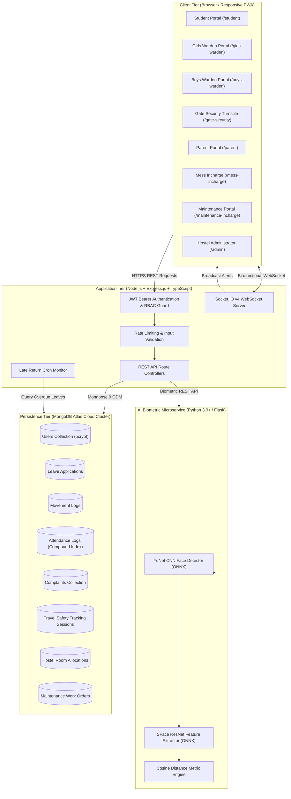
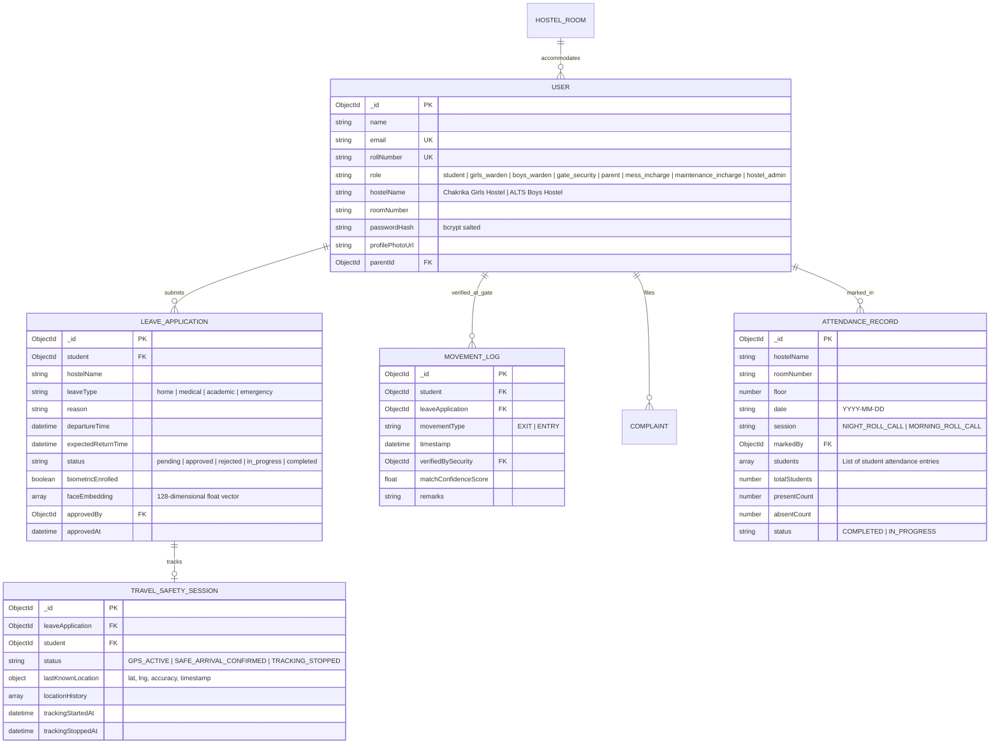
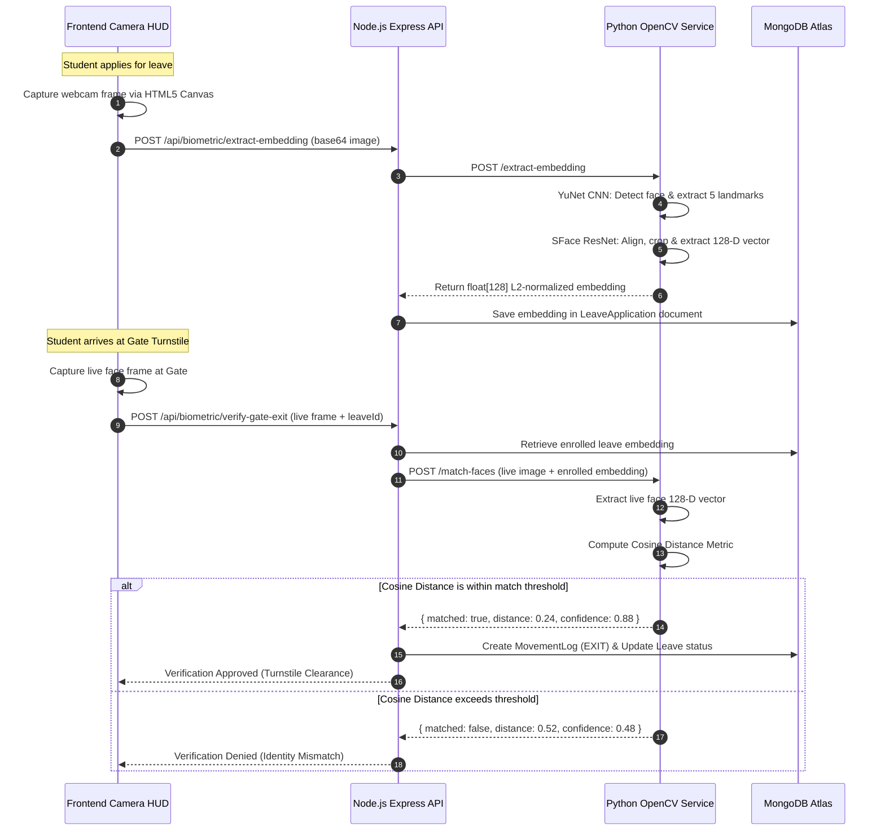

<div align="center">

# 🏛️ ALTS Hostel Portal
### Smart Hostel Automation, Deep Learning Facial Biometrics & Real-Time Student Safety Platform

[](http://alts.edu.in)
[](http://alts.edu.in)
[](#-license)

<br/>

[](#-technology-stack)
[](#-technology-stack)
[](#-technology-stack)
[](#-technology-stack)
[](#-face-recognition-workflow)
[](#-how-the-system-works-workflows)

<p align="center">
  <b>A comprehensive, enterprise-grade digital hostel management system engineered for residential campuses.</b><br>
  Integrates multi-role administrative workflows, leave lifecycle automation, deep-learning facial biometrics, digital QR gate passes, room-level roll-call attendance, grievance redressal, and real-time GPS travel safety tracking.
</p>

[Key Features](#-key-features) • [System Architecture](#-system-architecture) • [User Roles](#-user-roles--permissions) • [Biometric Engine](#-face-recognition-workflow) • [Installation](#-installation-and-setup) • [API Documentation](#-api-documentation) • [Testing](#-testing-and-verification)

</div>

---

## 📋 Table of Contents

- [1. Project Title & Overview](#1-project-title--overview)
- [2. Problem Statement & Solution](#2-problem-statement--solution)
- [3. Key Features](#3-key-features)
- [4. User Roles & Permissions](#4-user-roles--permissions)
- [5. How the System Works (Workflows)](#5-how-the-system-works-workflows)
- [6. System Architecture](#6-system-architecture)
- [7. Technology Stack](#7-technology-stack)
- [8. Project Folder Structure](#8-project-folder-structure)
- [9. Installation and Setup](#9-installation-and-setup)
- [10. Environment Variables](#10-environment-variables)
- [11. API Documentation](#11-api-documentation)
- [12. Database Design & Data Models](#12-database-design--data-models)
- [13. Face Recognition Workflow](#13-face-recognition-workflow)
- [14. Security and Privacy](#14-security-and-privacy)
- [15. Screenshots & Dashboard Tour](#15-screenshots--dashboard-tour)
- [16. Testing and Verification](#16-testing-and-verification)
- [17. Future Enhancements](#17-future-enhancements)
- [18. Contributors & Team](#18-contributors--team)
- [19. License](#19-license)
- [20. Acknowledgements](#20-acknowledgements)

---

## 1. Project Title & Overview

### **ALTS Hostel Portal**
*Next-Generation Institutional Residential Governance & Biometric Movement Authentication Platform*

Developed at the **Department of Computer Science and Engineering**, **Anantha Lakshmi Institute of Technology & Sciences (Autonomous)**, Anantapur, Andhra Pradesh, India.

The **ALTS Hostel Portal** is a production-ready, full-stack campus management platform that modernizes residential hostel administration across **Chakrika Girls Hostel** and **ALTS Boys Hostel**. By uniting high-speed RESTful services, persistent WebSocket event streaming, deep learning computer vision, and reactive TypeScript frontends, the system eliminates administrative friction, manual ledger tracking, and security vulnerabilities associated with paper-based leave slips and unsupervised gate movements.

---

## 2. Problem Statement & Solution

### The Campus Residential Challenge
Traditional university hostels struggle with fragmented and vulnerable operational processes:
* **Paper-Based Leave Applications**: Vulnerable to physical loss, forgery, delayed warden approvals, and lack of historical audit trails.
* **Gate Security Impersonation & Proxy**: Guards rely on printed passes or manual registers, making identity spoofing, duplicate departures, or unauthorized exits easy to execute.
* **Disconnected Parent Awareness**: Guardians often have zero real-time visibility into whether their ward has departed campus, arrived at their transit hub, or safely reached home.
* **Manual Paper Attendance**: Wardens spend hours manually calling roll numbers and transcribing physical register books, leading to delayed reporting of missing students.
* **Uncoordinated Grievance Redressal**: Food quality complaints, broken electrical fittings, and plumbing emergencies are logged verbally or in disparate books with no SLA tracking.

### The ALTS Hostel Portal Solution
1. **End-to-End Digital Leave Lifecycle**: Submissions are routed directly to the student's designated hostel warden queue (**Chakrika Girls Hostel** or **ALTS Boys Hostel**) with instant push notifications.
2. **Leave-Bound Biometric Enrollment**: When a student requests leave, they capture a fresh biometric frame via HTML5 video; a Python microservice extracts a tamper-proof 128-dimensional embedding vector tied specifically to that leave application.
3. **Turnstile Biometric Verification**: At the campus gate, security verifies the student's face live via OpenCV YuNet CNN and SFace ResNet models. Departure clearance is granted *only* when the cosine distance between the gate capture and the leave biometric meets the rigorous security threshold ($d \le 0.38$).
4. **GPS Travel Safety Radar**: Once verified at the gate, students activate journey tracking. Real-time GPS coordinates stream over WebSockets to the student's parent and warden, calculating distance-to-destination and auto-terminating upon confirmed arrival or return to campus.
5. **Room-Wise Attendance Suite**: Wardens access floor-by-floor room rosters with live visual avatars, single-click "Mark All Present" functionality, attendance completion metrics, and date-range history.
6. **Centralized Grievance & Facility Management**: Dedicated interfaces for mess food feedback, weekly menu curation, maintenance work orders, room inspections, and student billing ledgers.

---

## 3. Key Features

| Category | Feature | Status | Description |
| :--- | :--- | :---: | :--- |
| **Authentication & RBAC** | Multi-Role JWT Auth | **Completed** | Salted bcrypt (10 rounds) password hashing, Bearer JWT authorization, and strict RBAC middleware across 8 distinct institutional roles. |
| **Student Portal** | Digital Leave Management | **Completed** | Interactive leave request generator with departure/return datetime selection, emergency contact binding, and webcam facial biometric capture. |
| **Student Portal** | Digital Gate Pass with QR | **Completed** | Dynamic gate pass generation with encrypted cryptographic payload, QR code, warden authorization status, and departure timestamps. |
| **Student Portal** | Grievance Submissions | **Completed** | Student complaint filing across 7 distinct categories with real-time status updates and resolution commentary. |
| **Warden Portals** | Hostel-Specific Queues | **Completed** | Independent workflows for **Chakrika Girls Hostel** and **ALTS Boys Hostel** to review, approve, or reject student leave requests. |
| **Warden Portals** | Room-Wise Attendance | **Completed** | Floor-wise room navigation, visual student cards, Green (Present) / Red (Absent) toggles, Mark-All-Present, and daily completion logs. |
| **Warden Portals** | Outside-Campus Monitoring | **Completed** | Live monitor displaying currently checked-out students, expected return times, overdue indicators, and guardian emergency contact details. |
| **AI Biometrics** | OpenCV Deep Neural Net | **Completed** | Microservice running YuNet CNN for 5-point landmark face detection and SFace ResNet for 128-D L2-normalized feature vector generation. |
| **AI Biometrics** | Gate Match & Verification | **Completed** | Live gate camera capture matched against enrolled leave biometric using calibrated Cosine Distance metric ($d \le 0.38$). |
| **Gate Security** | Movement Turnstile HUD | **Completed** | Searchable directory of approved student leaves, instant camera modal verification, and automated check-out/check-in movement logging. |
| **Parent Portal** | Real-Time Ward Radar | **Completed** | Guardian visibility into active leaves, approved gate passes, movement audit logs, and simulated fee payment ledgers. |
| **Safety & Tracking** | Live GPS Travel Safety | **Completed** | Real-time geolocation broadcasting over Socket.IO during approved journeys with arrival confirmation and automatic safe-zone shutdown. |
| **Administration** | Master Admin Portal | **Completed** | Executive KPI dashboard, user account provisioning, hostel room inventory, cross-department complaint triage, and system monitoring. |
| **Mess Management** | Dining Operations | **Completed** | 7-day weekly meal schedules, dietary menu publishing, meal timing announcements, and student food complaint resolution. |
| **Maintenance** | Facility Work Orders | **Completed** | Maintenance ticket assignment, room electrical/plumbing inspection logs, work order lifecycle management (`PENDING` $\to$ `IN_PROGRESS` $\to$ `RESOLVED`). |

---

## 4. User Roles & Permissions

The ALTS Hostel Portal enforces strict Role-Based Access Control (RBAC) across 8 system roles:

```text
[STUDENT] ────► Leave Request + Biometric Enrollment + Gate Pass + GPS Broadcast
[GIRLS WARDEN]► Chakrika Hostel Approval + Attendance + Night Roll Call + Student Directory
[BOYS WARDEN] ─► ALTS Hostel Approval + Attendance + Night Roll Call + Student Directory
[GATE SECURITY]► Live Face Verification Turnstile + Check-Out / Check-In Movement Logs
[PARENT] ─────► Ward Movement Oversight + GPS Journey Radar + Institutional Fee Ledger
[MESS INCHARGE]► Weekly Meal Scheduling + Dietary Menus + Food Complaint Resolution
[MAINTENANCE] ─► Work Order Tickets + Room Inspections + Facility Repair Status
[HOSTEL ADMIN] ─► Master KPI Analytics + User Provisioning + Departmental Complaint Triage
```

### Permissions Matrix

| Operational Capability | Student | Girls Warden | Boys Warden | Gate Security | Parent | Mess Incharge | Maintenance Incharge | Hostel Admin |
| :--- | :---: | :---: | :---: | :---: | :---: | :---: | :---: | :---: |
| **Apply for Leave & Enroll Face** | ✅ | ❌ | ❌ | ❌ | ❌ | ❌ | ❌ | ❌ |
| **Approve Chakrika Girls Leaves** | ❌ | ✅ | ❌ | ❌ | ❌ | ❌ | ❌ | ✅ |
| **Approve ALTS Boys Leaves** | ❌ | ❌ | ✅ | ❌ | ❌ | ❌ | ❌ | ✅ |
| **Execute Gate Biometric Exit** | ❌ | ❌ | ❌ | ✅ | ❌ | ❌ | ❌ | ✅ |
| **Execute Gate Return Entry** | ❌ | ❌ | ❌ | ✅ | ❌ | ❌ | ❌ | ✅ |
| **Mark Room-Wise Attendance** | ❌ | ✅ (Girls) | ✅ (Boys) | ❌ | ❌ | ❌ | ❌ | ✅ |
| **Broadcast Live GPS Coordinates** | ✅ | ❌ | ❌ | ❌ | ❌ | ❌ | ❌ | ❌ |
| **Track Ward's GPS Journey** | ❌ | ✅ | ✅ | ❌ | ✅ (Ward) | ❌ | ❌ | ✅ |
| **Update Mess Weekly Menus** | ❌ | ❌ | ❌ | ❌ | ❌ | ✅ | ❌ | ✅ |
| **Resolve Facility Work Orders** | ❌ | ❌ | ❌ | ❌ | ❌ | ❌ | ✅ | ✅ |
| **Manage Users & Provision Roles** | ❌ | ❌ | ❌ | ❌ | ❌ | ❌ | ❌ | ✅ |
| **Triage All Campus Complaints** | ❌ | ❌ | ❌ | ❌ | ❌ | ❌ | ❌ | ✅ |

---

## 5. How the System Works (Workflows)

### A. Student Registration and Login
1. The student navigates to `http://localhost:5173/login`.
2. The student enters their institutional email or student Roll Number (e.g., `21CS042`) and password.
3. The Express backend queries MongoDB, verifies the salted bcrypt hash, generates a signed JSON Web Token (JWT) containing the user's role and hostel affiliation, and returns the session payload.
4. The client redirects to the appropriate portal root (`/student`).

### B. Leave Application Submission & Biometric Capture
1. The student opens the **Apply Leave** interface.
2. They specify the leave category (*Home Visit, Medical, Academic, Emergency*), reason, departure date/time, expected return date/time, and parent contact details.
3. **Biometric Face Capture**: The browser initiates the HTML5 camera stream via `navigator.mediaDevices.getUserMedia`.
4. The student clicks **Capture Face**. An HTML5 canvas extracts the raw video frame and converts it to a high-resolution base64 JPEG payload.
5. The frontend transmits the frame to the backend, which forwards it to the Python OpenCV microservice (`/extract-embedding`).
6. The service executes YuNet face detection and SFace feature extraction, returning a genuine 128-dimensional floating-point vector.
7. The leave application is persisted in MongoDB with `biometricEnrolled: true` and `status: "pending"`.
8. A real-time Socket.IO event `new_leave_application` is emitted to the designated hostel warden.

### C. Warden Review and Approval
1. The Girls Warden (`/girls-warden`) or Boys Warden (`/boys-warden`) views their respective pending leave queue.
2. The UI renders the student's academic credentials, leave reason, departure window, parent contact, and biometric enrollment confirmation badge.
3. The warden clicks **Approve**.
4. The backend updates the record in MongoDB to `status: "approved"` and emits a real-time event `leave_approved`.
5. The student's portal receives the update and activates their **Digital Gate Pass** modal with an encrypted verification QR code.
6. The Gate Security portal instantly updates its **Approved Leaves** queue in real time without page refresh.

### D. Gate Security Verification and Exit
1. The student presents themselves at the campus security checkpoint.
2. The gate security officer searches for the student by name or Roll Number on the Gate Security Dashboard (`/gate-security`).
3. The security officer clicks **Verify & Record Exit**.
4. The system opens the live security camera HUD.
5. The officer captures the student's live face at the gate.
6. The backend sends the live gate image and the student's enrolled leave biometric embedding to the Python face service (`/match-faces`).
7. **Biometric Match Evaluation**:
   * If Cosine Distance $> 0.38$ (or confidence $< 70\%$): **Clearance Denied** (Visual alert, exit prevented).
   * If Cosine Distance $\le 0.38$: **Identity Confirmed**.
8. Upon successful match:
   * A new `MovementLog` is created with `movementType: "EXIT"`, timestamp, gate security officer ID, and confidence score.
   * The leave application status updates to `in_progress`.
   * A travel safety tracking session is initialized in MongoDB (`status: "WAITING_FOR_CONSENT"`).
   * Real-time notifications and SMS-style alerts are dispatched to the student's parent and hostel warden.

### E. Return Verification and Entry
1. When the student returns to campus, the gate security officer accesses the **Return Check-In** tab.
2. The student's face is recaptured through the live security camera.
3. Biometric verification executes against the student's registered template.
4. Upon verification, the backend creates a `MovementLog` with `movementType: "ENTRY"`.
5. The leave application status updates to `completed`.
6. Any active GPS travel safety tracking session is immediately auto-terminated.
7. Real-time arrival notifications are pushed to the parent and warden dashboards.

### F. Parent Monitoring & Alerts
1. Guardians log in using their verified credentials (`/parent`).
2. The dashboard displays their ward's current status (*In Campus*, *On Approved Leave*, or *Transit Active*).
3. Parents can inspect detailed departure/return logs, warden approval stamps, and view fee balance ledgers.
4. If the student has departed campus on an approved journey, the parent can monitor their transit path on the **Travel Safety Radar**.

### G. Room-Wise Attendance Marking
1. Wardens navigate to the **Attendance Management** module.
2. Rooms are grouped by floor for **Chakrika Girls Hostel** or **ALTS Boys Hostel**.
3. Clicking a room displays each resident student's photo, name, roll number, and current presence status.
4. Wardens can toggle individual students (**GREEN - PRESENT** or **RED - ABSENT**) or click **Mark All Present**.
5. The warden saves the session. The system records the attendance in MongoDB with compound indexing `{ hostelName, roomNumber, date, session }`, updating real-time attendance completion statistics.

### H. Complaint Redressal Lifecycle
1. Students file complaints specifying category (*Mess Food, Hostel Maintenance, Room Cleaning, Water Supply, Electricity, Security, Other*), room number, and description.
2. Dual-notification routing immediately alerts both the Hostel Admin and the relevant department in-charge (Mess Incharge or Maintenance Incharge).
3. The department in-charge assigns technician staff and updates the status from `PENDING` $\to$ `IN_PROGRESS`.
4. Once repaired, the ticket is marked `RESOLVED` with resolution notes. The student receives an instant push notification.

### I. Mess Schedule and Food Feedback
1. The Mess Incharge curates the 7-day breakfast, lunch, snacks, and dinner menus (`/mess-incharge`).
2. Students view the daily dining menu and meal timings in real time on their portal.
3. Students can submit direct food feedback and quality ratings, allowing administration to track dietary satisfaction.

### J. GPS-Based Travel Safety Tracking & Auto-Termination
1. When a student checks out at the gate, their portal prompts them to start GPS safety tracking.
2. The student grants browser location permissions (`navigator.geolocation.watchPosition`).
3. GPS coordinates (latitude, longitude, speed, heading, accuracy) stream to the backend at regular intervals over Socket.IO (`travel:location_update`).
4. The system calculates distance to destination using the Haversine formula and broadcasts coordinates to authorized parent and warden sockets.
5. **Safe Arrival & Auto-Termination**:
   * The student or parent can click **Confirm Safe Arrival**.
   * If the student re-enters the campus gate, the backend automatically halts tracking (`status: "TRACKING_STOPPED"`) to guarantee student privacy.

---

## 6. System Architecture

The ALTS Hostel Portal utilizes a decoupled, event-driven multi-tier architecture designed for high availability, low latency, and robust fault tolerance.



---

## 7. Technology Stack

### Core Frameworks & Libraries

| Tier | Technology | Version | Purpose |
| :--- | :--- | :---: | :--- |
| **Frontend Framework** | React | `^19.0.0` | Declarative, component-driven UI architecture with React hooks. |
| **Language (Client)** | TypeScript | `^5.7.2` | Complete end-to-end type safety, strict interface contracts. |
| **Build Tooling** | Vite | `^8.0.0` | Ultra-fast Hot Module Replacement (HMR) and optimized rollup bundler. |
| **Styling** | Tailwind CSS | `^4.0.0` | Modern utility-first CSS framework with dynamic theme variables. |
| **Icons & Visuals** | Lucide React | `^1.16.0` | Modern, consistent iconography across all 8 portals. |
| **Charts & Metrics** | Recharts | `^3.7.0` | Responsive SVG charts for attendance and leave analytics. |
| **Backend Runtime** | Node.js | `>=18.0.0` | Asynchronous event-driven JavaScript server runtime. |
| **Web Server** | Express.js | `^4.21.2` | RESTful API server routing, middleware composition, and error handling. |
| **Language (Server)** | TypeScript | `^5.7.3` | Type-safe backend controllers, services, and Mongoose interfaces. |
| **Database** | MongoDB Atlas | Cloud / `v7.0+` | Scalable NoSQL document store with ACID multi-document transactions. |
| **ODM** | Mongoose | `^9.0.0` | Object Data Modeling library with strict validation schemas and indexes. |
| **Real-Time Engine** | Socket.IO | `^4.8.1` | Bidirectional, low-latency WebSocket communication. |
| **Biometric Vision** | OpenCV Python | `^4.8.0` | Computer vision library executing YuNet CNN and SFace ResNet models. |
| **AI Microservice** | Flask / HTTP | `^3.0.0` | Lightweight Python microservice serving biometric inference endpoints. |
| **Password Security** | bcryptjs | `^3.0.2` | Cryptographic adaptive key-derivation function (10 salt rounds). |
| **Token Auth** | jsonwebtoken | `^9.0.2` | RFC 7519 industry-standard cryptographically signed JWT bearer tokens. |
| **File Uploads** | Multer | `^1.4.5` | Multipart/form-data handler with disk storage and mime validation. |

---

## 8. Project Folder Structure

```text
Hostel_mini_pro/
│
├── frontend/                              # Client-side React 19 Application
│   ├── public/                            # Static icons, favicons, SVG assets
│   ├── src/
│   │   ├── assets/                        # Hero images and branding vectors
│   │   ├── components/
│   │   │   ├── common/                    # Shared reusable widgets
│   │   │   │   ├── Avatar.tsx             # Fallback & profile image renderer
│   │   │   │   ├── CameraViewfinder.tsx   # HTML5 video stream & frame grabber
│   │   │   │   ├── GateBiometricVerificationModal.tsx # Gate live matching HUD
│   │   │   │   ├── GatePassModal.tsx      # Dynamic gate pass with QR code
│   │   │   │   ├── LeaveBiometricCapture.tsx # Leave application face enrollment
│   │   │   │   ├── PartyBomberConfetti.tsx # Celebration animation effects
│   │   │   │   └── ProtectedRoute.tsx     # Route-level RBAC barrier
│   │   │   ├── layout/                    # Global shell layouts
│   │   │   │   ├── DashboardLayout.tsx    # Responsive sidebar + top navigation
│   │   │   │   ├── Navbar.tsx             # User profile menu, logout, notifications
│   │   │   │   └── Sidebar.tsx            # Role-specific contextual navigation
│   │   │   └── ui/                        # Low-level UI atoms (Button, Card, Modal, Toast)
│   │   ├── context/
│   │   │   └── AppContext.tsx             # Global state (auth, socket, notifications)
│   │   ├── pages/                         # 8 Dedicated Portal Page Suites
│   │   │   ├── admin/                     # Hostel Administrator Portal
│   │   │   ├── common/                    # User profile editing and password resets
│   │   │   ├── gate/                      # Gate Security Turnstile & Movement Logs
│   │   │   ├── maintenance/               # Maintenance Work Orders & Inspection Logs
│   │   │   ├── mess/                      # Mess Incharge Menus & Feedback
│   │   │   ├── parent/                    # Parent Ward Oversight & Travel Radar
│   │   │   ├── student/                   # Student Leave, Gate Pass & GPS Safety
│   │   │   ├── warden/                    # Girls & Boys Warden Approval & Attendance
│   │   │   ├── LandingPage.tsx            # Institutional public portal landing
│   │   │   └── LoginPage.tsx              # Universal unified role login
│   │   ├── services/
│   │   │   ├── api.ts                     # Axios/Fetch client with JWT interceptors
│   │   │   └── socket.ts                  # Socket.IO client instance and listener registry
│   │   ├── types/
│   │   │   └── index.ts                   # Universal TypeScript types & interfaces
│   │   ├── utils/                         # Avatar, formatting, and portal routing helpers
│   │   ├── App.tsx                        # Client routing table
│   │   └── main.tsx                       # React DOM entry point
│   ├── package.json                       # Frontend dependencies and build scripts
│   └── vite.config.ts                     # Vite configuration & proxy definitions
│
├── backend/                               # REST API & WebSocket Application
│   ├── src/
│   │   ├── config/                        # Database connection & env variable loaders
│   │   ├── controllers/                   # 14 Specialized REST Controllers
│   │   │   ├── admin.controller.ts        # Admin analytics, user provisioning, rooms
│   │   │   ├── attendance.controller.ts   # Room-wise roll call attendance
│   │   │   ├── auth.controller.ts         # Login, registration, profile, password
│   │   │   ├── biometric.controller.ts    # Biometric enrollment & turnstile verification
│   │   │   ├── complaint.controller.ts    # 7-category complaint submission & triage
│   │   │   ├── leave.controller.ts        # Leave application submission & approval
│   │   │   ├── maintenance.controller.ts  # Work order ticketing lifecycle
│   │   │   ├── mess.controller.ts         # Dining menu scheduling and announcements
│   │   │   ├── movement.controller.ts     # Gate check-out and check-in movement logs
│   │   │   ├── notification.controller.ts # In-app notification dispatcher
│   │   │   ├── parent.controller.ts       # Parent ward lookup and simulated fee payments
│   │   │   ├── travelSafety.controller.ts # GPS session initiation, tracking, auto-stop
│   │   │   └── user.controller.ts         # Student roster and user queries
│   │   ├── middleware/                    # Auth, RBAC, error handling, rate limiting
│   │   ├── models/                        # Mongoose Data Models
│   │   │   ├── attendance.model.ts        # Compound indexed room attendance
│   │   │   ├── complaint.model.ts         # Departmental complaints schema
│   │   │   ├── hostelRoom.model.ts        # Room allocations and occupant rosters
│   │   │   ├── leaveApplication.model.ts  # Leave requests with embedded 128-D vectors
│   │   │   ├── maintenanceRequest.model.ts# Facility work orders schema
│   │   │   ├── movementLog.model.ts       # Gate entry/exit biometric audit trail
│   │   │   ├── notification.model.ts      # Push notification records
│   │   │   ├── travelSafety.model.ts      # GPS coordinates and safe arrival records
│   │   │   └── user.model.ts              # Core user records with salted passwords
│   │   ├── routes/                        # Express route definitions
│   │   ├── services/                      # Socket.IO broadcaster, seed data, late monitor
│   │   ├── app.ts                         # Express app middleware pipeline
│   │   └── server.ts                      # HTTP and WebSocket bootstrap entry point
│   ├── package.json                       # Backend dependencies and compiler scripts
│   └── tsconfig.json                      # Server TypeScript configuration
│
├── face_service/                          # OpenCV Deep Learning Microservice
│   ├── download_models.py                 # Automated ONNX model weight downloader
│   ├── service.py                         # Multi-threaded HTTP inference server (Port 5001)
│   └── models/                            # ONNX weights (YuNet + SFace) [Ignored in Git]
│
├── scripts/                               # Development utilities
│   └── dev.mjs                            # Concurrent multi-process launcher
│
├── documentation/                         # Project documentation
│   ├── ARCHITECTURE.md                    # Technical architecture specification
│   └── PORTALS_AND_CREDENTIALS.md         # Reference accounts and test credentials
│
├── .env.example                           # Safe environment configuration template
├── .gitignore                             # Git exclusion rules (Secrets, node_modules, ONNX)
├── package.json                           # Root workspace orchestrator
└── README.md                              # Master project documentation
```

---

## 9. Installation and Setup

### Prerequisites
Ensure your local environment has the following runtimes installed:
* **Node.js**: `v18.x` or `v20.x` LTS ([Download Node.js](https://nodejs.org/))
* **npm**: `v9.x` or `v10.x`
* **Python**: `v3.9` to `v3.12` ([Download Python](https://www.python.org/))
* **MongoDB**: A running local MongoDB instance or a free [MongoDB Atlas Cluster](https://www.mongodb.com/atlas) connection URI.

---

### Step 1: Clone the Repository
```bash
git clone https://github.com/kolimimohammadAdil/Hostel_Management_System.git
cd Hostel_Management_System
```

---

### Step 2: Configure Environment Variables
Copy `.env.example` to `backend/.env` and update credentials:
```powershell
# Windows PowerShell
Copy-Item .env.example backend/.env
```
```bash
# Linux / macOS
cp .env.example backend/.env
```

Open `backend/.env` in your editor and configure your MongoDB connection string and JWT secret:
```env
PORT=5000
MONGODB_URI=mongodb+srv://<username>:<password>@cluster0.mongodb.net/alts_hostel_db?retryWrites=true&w=majority
JWT_SECRET=super_secret_jwt_key_alts_2026_change_in_production
FRONTEND_URL=http://localhost:5173
FACE_SERVICE_URL=http://127.0.0.1:5001
```

---

### Step 3: Install Node Dependencies
Install packages for both frontend and backend from the root directory:
```bash
# Install frontend packages
npm --prefix frontend install

# Install backend packages
npm --prefix backend install
```

---

### Step 4: Setup Python Facial Biometrics Microservice
1. Install Python dependencies:
   ```bash
   pip install opencv-python flask numpy pillow
   ```
2. Download the official OpenCV YuNet detector and SFace recognizer ONNX models:
   ```bash
   python face_service/download_models.py
   ```
   > [!NOTE]
   > The script automatically downloads `face_detection_yunet_2023mar.onnx` and `face_recognition_sface_2021dec.onnx` into `face_service/models/`.

---

### Step 5: Start the Development Servers

#### Option A: Run All Services Simultaneously
```bash
npm run dev
```
This executes `scripts/dev.mjs`, which orchestrates both the Vite frontend server and Express backend server in parallel.

In a separate terminal, launch the Python biometric microservice:
```bash
npm run dev:face
```

#### Option B: Run Services Individually
| Service | Command | URL |
| :--- | :--- | :--- |
| **Frontend Web App** | `npm run dev:frontend` | `http://localhost:5173` |
| **Backend REST & WebSocket** | `npm run dev:backend` | `http://localhost:5000` |
| **Face Biometrics Microservice** | `npm run dev:face` | `http://127.0.0.1:5001` |

---

### Step 6: Access the Application
Open your browser and navigate to:
```
http://localhost:5173/login
```

#### Default Test Accounts

| Portal Role | Email / Username | Alternate ID (Roll No) | Password | Default Hostel |
| :--- | :--- | :---: | :--- | :--- |
| **Student (Girls)** | `student.priya@hostelguard.edu` | `21CS042` | `HostelGuard#2026` | Chakrika Girls Hostel |
| **Student (Boys)** | `student.aarav@hostelguard.edu` | `21CS089` | `HostelGuard#2026` | ALTS Boys Hostel |
| **Girls Hostel Warden** | `warden.girls@hostelguard.edu` | — | `HostelGuard#2026` | Chakrika Girls Hostel |
| **Boys Hostel Warden** | `warden.boys@hostelguard.edu` | — | `HostelGuard#2026` | ALTS Boys Hostel |
| **Gate Security** | `security.gate@hostelguard.edu` | — | `HostelGuard#2026` | Campus Main Gate |
| **Parent Portal** | `parent.sharma@hostelguard.edu` | — | `HostelGuard#2026` | Ward: Priya Sharma |
| **Mess Incharge** | `mess.incharge@hostelguard.edu` | — | `HostelGuard#2026` | Central Dining Hall |
| **Maintenance Incharge** | `maintenance.incharge@hostelguard.edu` | — | `HostelGuard#2026` | Campus Facilities |
| **Hostel Administrator** | `admin.hostel@alts.edu.in` | — | `AdminSecure#2026` | All Hostels |

---

## 10. Environment Variables

The application relies on configuration variables stored in `backend/.env`. A complete template is provided in `.env.example`:

```env
# =================================================================
# ALTS Hostel Portal — Environment Configuration
# =================================================================

# Server Network Configuration
PORT=5000
NODE_ENV=development

# Database Configuration (MongoDB Atlas or Local MongoDB)
MONGODB_URI=mongodb+srv://<username>:<password>@cluster0.mongodb.net/alts_hostel_db?retryWrites=true&w=majority

# JSON Web Token Secret (Use minimum 32 random characters in production)
JWT_SECRET=super_secret_jwt_key_alts_2026_change_in_production
JWT_EXPIRES_IN=7d

# Cross-Origin Resource Sharing (CORS) Configuration
FRONTEND_URL=http://localhost:5173

# Python Face Recognition Microservice Configuration
FACE_SERVICE_URL=http://127.0.0.1:5001
FACE_SERVICE_PORT=5001
FACE_SERVICE_HOST=0.0.0.0

# Local Uploads Directory Configuration
UPLOAD_DIR=uploads
MAX_FILE_SIZE_MB=5
```

---

## 11. API Documentation

### REST API Reference

All protected endpoints require the HTTP Header: `Authorization: Bearer <JWT_TOKEN>`.

#### 🔐 Authentication & Profile (`/api/auth`)
| Method | Endpoint | Access Level | Description |
| :---: | :--- | :---: | :--- |
| `POST` | `/api/auth/login` | Public | Authenticates credentials; returns user profile and JWT. |
| `POST` | `/api/auth/register` | Public / Admin | Registers a new student or institutional account. |
| `GET` | `/api/auth/me` | Authenticated | Retrieves current authenticated session user profile. |
| `PUT` | `/api/auth/profile` | Authenticated | Updates personal profile information and emergency contact. |
| `POST` | `/api/auth/upload-photo` | Authenticated | Uploads profile photo (`multipart/form-data`, $\le 5\text{MB}$). |
| `PUT` | `/api/auth/change-password` | Authenticated | Validates existing password and updates to new salted hash. |

#### 📝 Leave Applications (`/api/leaves`)
| Method | Endpoint | Access Level | Description |
| :---: | :--- | :---: | :--- |
| `POST` | `/api/leaves` | Student | Submits new leave with biometric enrollment embedding. |
| `GET` | `/api/leaves/my-leaves` | Student | Fetches all historical and active leave requests for student. |
| `GET` | `/api/leaves/warden/queue` | Warden / Admin | Fetches pending leave applications filtered by warden's hostel. |
| `PATCH` | `/api/leaves/:id/status` | Warden / Admin | Updates leave status (`approved` or `rejected`) with remarks. |
| `GET` | `/api/leaves/:id/gate-pass` | Student / Security | Generates digital gate pass payload with encrypted QR data. |
| `GET` | `/api/leaves/outside-campus` | Warden / Security | Retrieves all students currently outside campus grounds. |

#### 👤 Biometrics & Face Service (`/api/biometric`)
| Method | Endpoint | Access Level | Description |
| :---: | :--- | :---: | :--- |
| `POST` | `/api/biometric/extract-embedding` | Authenticated | Extracts 128-D embedding from webcam base64 image frame. |
| `POST` | `/api/biometric/verify-gate-exit` | Gate Security | Verifies student face live at gate and creates exit movement log. |
| `POST` | `/api/biometric/verify-gate-return` | Gate Security | Verifies student face live at gate and creates return entry log. |

#### 🚪 Student Movements & Gate Logs (`/api/movements`)
| Method | Endpoint | Access Level | Description |
| :---: | :--- | :---: | :--- |
| `GET` | `/api/movements` | Security / Warden | Fetches real-time gate entry/exit logs with filter options. |
| `GET` | `/api/movements/approved-leaves` | Gate Security | Fetches all warden-approved leaves awaiting physical gate exit. |
| `GET` | `/api/movements/student/:id` | Student / Parent | Fetches movement history for a specific student. |

#### 📅 Attendance Management (`/api/attendance`)
| Method | Endpoint | Access Level | Description |
| :---: | :--- | :---: | :--- |
| `GET` | `/api/attendance/rooms` | Warden / Admin | Fetches list of hostel rooms with student counts and completion. |
| `GET` | `/api/attendance/room/:roomNumber` | Warden / Admin | Retrieves student roster for specific room with current status. |
| `POST` | `/api/attendance/save` | Warden / Admin | Persists marked room attendance records to MongoDB Atlas. |
| `GET` | `/api/attendance/history` | Warden / Admin | Fetches attendance logs filtered by date, room, and session. |

#### 📢 Grievance & Complaints (`/api/complaints`)
| Method | Endpoint | Access Level | Description |
| :---: | :--- | :---: | :--- |
| `POST` | `/api/complaints` | Student | Registers a new complaint across 7 operational categories. |
| `GET` | `/api/complaints/my` | Student | Retrieves all complaints filed by the authenticated student. |
| `GET` | `/api/complaints` | Admin / Staff | Retrieves department-specific or campus-wide complaints list. |
| `PATCH` | `/api/complaints/:id/status` | Admin / Staff | Updates complaint status (`IN_PROGRESS`, `RESOLVED`, etc.). |
| `POST` | `/api/complaints/:id/comments` | Authenticated | Appends discussion comment to complaint ticket. |

#### 📍 GPS Travel Safety Tracking (`/api/travel-safety`)
| Method | Endpoint | Access Level | Description |
| :---: | :--- | :---: | :--- |
| `POST` | `/api/travel-safety/start` | Student | Grants consent and activates GPS travel safety session. |
| `POST` | `/api/travel-safety/location` | Student | Ingests live latitude/longitude coordinate sample. |
| `GET` | `/api/travel-safety/active` | Parent / Warden | Fetches live coordinates and journey metrics for active leave. |
| `POST` | `/api/travel-safety/confirm-arrival`| Student / Parent | Confirms safe arrival at destination and terminates tracking. |
| `POST` | `/api/travel-safety/stop` | Warden / Admin | Administratively halts journey tracking session. |

#### 🛠️ Administrator & Monitoring (`/api/admin`)
| Method | Endpoint | Access Level | Description |
| :---: | :--- | :---: | :--- |
| `GET` | `/api/admin/metrics` | Hostel Admin | Fetches master KPI analytics (occupancy, active leaves, issues). |
| `GET` | `/api/admin/users` | Hostel Admin | Queries and filters all campus accounts across all 8 roles. |
| `POST` | `/api/admin/users` | Hostel Admin | Provisions new administrative or warden staff account. |
| `GET` | `/api/admin/rooms` | Hostel Admin | Fetches global room inventory, capacity, and bed allocations. |

---

## 12. Database Design & Data Models

The system uses MongoDB Atlas with strictly validated Mongoose schemas.

### Primary Collections & Schema Highlights



### Key Performance Indexes
* **Attendance Uniqueness**:
  ```javascript
  attendanceSchema.index(
    { hostelName: 1, roomNumber: 1, date: 1, session: 1 },
    { unique: true }
  );
  ```
  Guarantees that a room cannot have duplicate attendance submissions for the same roll-call session on any given calendar date.
* **Movement Log Chronology**:
  ```javascript
  movementLogSchema.index({ student: 1, timestamp: -1 });
  ```
  Enables sub-millisecond retrieval of a student's most recent gate transition.
* **Active Leave Lookups**:
  ```javascript
  leaveApplicationSchema.index({ student: 1, status: 1 });
  leaveApplicationSchema.index({ hostelName: 1, status: 1 });
  ```

---

## 13. Face Recognition Workflow

The facial biometric engine operates as an independent microservice powered by **OpenCV's Deep Neural Network (DNN)** module.

### Microservice Pipeline



### Mathematical Formulation

1. **Face Detection (YuNet CNN)**:
   Detects faces in arbitrary poses with bounding box coordinates and 5 facial landmark locations:
   $$\mathcal{L} = \{ \mathbf{p}_{\text{right\_eye}}, \mathbf{p}_{\text{left\_eye}}, \mathbf{p}_{\text{nose}}, \mathbf{p}_{\text{right\_mouth}}, \mathbf{p}_{\text{left\_mouth}} \}$$
   Filtered by non-maximum suppression (NMS threshold: 0.3, score threshold: 0.6).

2. **Feature Extraction (SFace ResNet)**:
   Performs affine transformation to align the face based on landmark positions, crops to canonical dimensions, and outputs an L2-normalized floating-point vector:
   $$\mathbf{v} \in \mathbb{R}^{128}, \quad \|\mathbf{v}\|_2 = \sqrt{\sum_{i=1}^{128} v_i^2} = 1.0$$

3. **Cosine Distance Metric**:
   Given enrolled leave vector $\mathbf{u}$ and live gate vector $\mathbf{v}$:
   $$D_{\text{cosine}}(\mathbf{u}, \mathbf{v}) = 1 - \frac{\mathbf{u} \cdot \mathbf{v}}{\|\mathbf{u}\|_2 \|\mathbf{v}\|_2} = 1 - \sum_{i=1}^{128} u_i v_i$$
   The security turnstile enforces:
   $$\text{Decision} = \begin{cases} \text{GRANT CLEARANCE}, & \text{if } D_{\text{cosine}}(\mathbf{u}, \mathbf{v}) \le 0.38 \\ \text{DENY ACCESS}, & \text{otherwise} \end{cases}$$

---

## 14. Security and Privacy

* **Zero Plaintext Credentials**: All user passwords are salted and hashed using bcrypt (10 rounds) before persistence in MongoDB.
* **Token Protection**: JWTs are signed with a minimum 256-bit secret key, enforcing role claims on every protected API route.
* **Biometric Privacy**:
  * Raw webcam images captured during leave applications are discarded from disk memory once the 128-dimensional embedding is extracted.
  * Stored embeddings are irreversible mathematical projections from which original human facial images cannot be reconstructed.
* **GPS Travel Tracking Privacy**:
  * Location tracking is **strictly conditional** on the student having an approved, active leave pass and explicitly granting browser location consent.
  * Tracking operates solely while the student is in transit between campus and destination.
  * Sessions automatically terminate immediately upon arrival confirmation or upon physical return through the campus gate.
  * Coordinates are accessible exclusively by the student's designated parent and hostel warden.
* **Cross-Hostel Tenant Isolation**: Girls Warden permissions are restricted exclusively to Chakrika Girls Hostel students, while Boys Warden permissions are locked to ALTS Boys Hostel students.

---

## 15. Screenshots & Dashboard Tour

Below are the primary user interfaces across the ALTS Hostel Portal:

### 1. Student Portal (`/student`)
The central workspace for students to apply for leave passes with webcam biometric capture, view digital QR gate passes, check daily mess schedules, file maintenance requests, and initiate live GPS travel safety tracking.

```text
+------------------------------------------------------------------------------------+
|  ALTS HOSTEL PORTAL                                 [Priya Sharma - 21CS042] [Logout] |
+------------------------------------------------------------------------------------+
|  [Dashboard] [Apply Leave] [My Gate Pass] [Mess Menu] [Complaints] [Travel Safety]  |
|                                                                                    |
|  Active Gate Pass: APPROVED                      Biometric Enrollment: CAPTURED    |
|  +-------------------------------------+   +------------------------------------+  |
|  | Leaving: Oct 31, 2026 - 10:00 AM    |   | [QR CODE]                          |  |
|  | Return:  Nov 02, 2026 - 06:00 PM    |   | Verified by: Warden S. Lakshmi     |  |
|  | Destination: Bangalore (Home)       |   | Status: Valid for Exit Checkpoint  |  |
|  +-------------------------------------+   +------------------------------------+  |
|                                                                                    |
|  [START GPS TRAVEL TRACKING] (Broadcasts live coordinates to Parent & Warden)      |
+------------------------------------------------------------------------------------+
```

### 2. Girls & Boys Warden Portals (`/girls-warden` & `/boys-warden`)
Dedicated review queues for hostel-specific leave requests, outside-campus student tracking, student directories, and night roll-call attendance.

```text
+------------------------------------------------------------------------------------+
|  CHAKRIKA GIRLS HOSTEL — WARDEN WORKSPACE                 [Warden Lakshmi] [Logout] |
+------------------------------------------------------------------------------------+
|  [Pending Leaves (3)] [Outside Campus (12)] [Attendance Management] [Announcements]|
|                                                                                    |
|  Pending Leave Review Queue:                                                       |
|  +-------------------------------------------------------------------------------+ |
|  | Student: Priya Sharma | Roll: 21CS042 | Room: G-204 | Biometric: ENROLLED     | |
|  | Reason: Sister's Wedding | Destination: Hyderabad | Out: Oct 31 | In: Nov 03   | |
|  | Parent: M. Sharma (9876543210)                                                | |
|  | [APPROVE LEAVE]   [REJECT LEAVE]                                              | |
|  +-------------------------------------------------------------------------------+ |
+------------------------------------------------------------------------------------+
```

### 3. Room-Wise Attendance Management (`/attendance`)
Visual floor-by-floor room grid allowing wardens to record daily attendance, mark all present with a single click, and review historical roll-call logs.

```text
+------------------------------------------------------------------------------------+
|  ROOM-WISE ATTENDANCE — ALTS BOYS HOSTEL                        Date: 2026-10-31   |
|  Session: Night Roll Call                              Floor: 2nd Floor            |
+------------------------------------------------------------------------------------+
|  Room 201 [Completed] (4/4 Present)       Room 202 [In Progress] (3/4 Present)     |
|  +--------------------------------------+ +--------------------------------------+ |
|  | [Photo] Aarav Patel    [PRESENT: Grn]| | [Photo] Rahul Verma    [PRESENT: Grn]| |
|  | [Photo] Vikram Singh   [PRESENT: Grn]| | [Photo] Karan Reddy    [PRESENT: Grn]| |
|  | [Photo] Rohan Rao      [PRESENT: Grn]| | [Photo] Aditya Kumar   [ABSENT: Red] | |
|  | [Photo] Sanjay Nair    [PRESENT: Grn]| | [Photo] Manoj Patil    [PRESENT: Grn]| |
|  | [SAVE ROOM ATTENDANCE]               | | [MARK ALL PRESENT] [SAVE ROOM]       | |
|  +--------------------------------------+ +--------------------------------------+ |
+------------------------------------------------------------------------------------+
```

### 4. Gate Security Turnstile (`/gate-security`)
Interactive turnstile HUD enabling security personnel to search approved leaves, launch live camera biometric matching, and log physical exits and entries.

```text
+------------------------------------------------------------------------------------+
|  CAMPUS GATE SECURITY — BIOMETRIC VERIFICATION TURNSTILE      [Officer Rao] [Logout]|
+------------------------------------------------------------------------------------+
|  Search Student: [ 21CS042                      ] [SEARCH]                         |
|                                                                                    |
|  Approved Student Awaiting Exit:                                                   |
|  Name: Priya Sharma | Roll: 21CS042 | Hostel: Chakrika Girls Hostel | Room: G-204  |
|  Approved Leave ID: LV-89421 | Biometric Enrolled: Yes | Status: APPROVED          |
|                                                                                    |
|  [ > LAUNCH LIVE CAMERA VERIFY & RECORD EXIT < ]                                   |
|                                                                                    |
|  +-------------------------------------------------------------------------------+ |
|  | LIVE CAMERA HUD: [Face Detected (YuNet)]  SFace Cosine Match: 0.22 (94.2%)    | |
|  | IDENTITY CONFIRMED: Priya Sharma                                              | |
|  | [RECORD EXIT & OPEN GATE]                                                     | |
|  +-------------------------------------------------------------------------------+ |
+------------------------------------------------------------------------------------+
```

### 5. Parent Portal & Travel Radar (`/parent`)
Oversight dashboard for parents to review ward leave approvals, gate movement history, simulated fee payments, and live GPS transit tracking.

```text
+------------------------------------------------------------------------------------+
|  ALTS PARENT PORTAL                                      [M. Sharma] [Logout]      |
|  Ward: Priya Sharma (21CS042) - Chakrika Girls Hostel - Room G-204                 |
+------------------------------------------------------------------------------------+
|  [Ward Overview] [Leave Approvals] [Movement History] [GPS Travel Radar] [Fees]    |
|                                                                                    |
|  LIVE JOURNEY SAFETY RADAR                                                         |
|  Status: IN TRANSIT (GPS Active)                                                   |
|  Departure Gate Exit: Oct 31, 2026 - 10:14 AM                                      |
|  Current Location: NH-44 near Gooty (Lat: 15.1182, Lng: 77.6321)                   |
|  Estimated Destination Arrival: 04:30 PM                                           |
|  Speed: 54 km/h | Accuracy: +/- 8m                                                 |
|                                                                                    |
|  [CONFIRM WARD SAFE ARRIVAL AT HOME]                                               |
+------------------------------------------------------------------------------------+
```

### 6. Master Administrator Portal (`/admin`)
Executive dashboard displaying campus occupancy statistics, user management, cross-department complaint resolution, and room inventory metrics.

---

## 16. Testing and Verification

The repository includes a comprehensive, automated test suite that validates everything from individual Mongoose models to live multi-service integration.

### Test Battery Execution Commands

```bash
# 1. Validate all Mongoose database schemas, types, and compound indexes (51 assertions)
npm run test:models

# 2. Validate attendance, complaint, admin, and travel safety schemas (43 assertions)
node backend/verify-new-modules.mjs

# 3. Test multi-role authentication, password hashing, and JWT authorization
npm run test:auth

# 4. Run full facial biometric suite against OpenCV microservice (13 test cases)
npm run test:face

# 5. Verify real-time Socket.IO notification push pipelines
npm run test:notifications

# 6. Test profile photo upload and static media serving
npm run test:profile

# 7. Verify live MongoDB Atlas CRUD transactions & persistence
npm run test:persistence

# 8. Test end-to-end frontend and backend API contracts
npm run test:integration
```

### Biometric Engine Test Cases (`npm run test:face`)
The OpenCV microservice test runner validates 13 distinct edge cases:
1. `PASS`: Valid face detection and 128-D embedding extraction.
2. `PASS`: Rejection when no face is present in image.
3. `PASS`: Rejection when multiple faces are detected in single frame.
4. `PASS`: High similarity score ($> 80\%$) for matching enrolled identity.
5. `PASS`: Rejection of un-enrolled / unknown identity (below threshold).
6. `PASS`: Graceful error handling for corrupted image payloads.
7. `PASS`: Access control barrier blocking unauthorized enrollment calls.
8. `PASS`: Access control barrier rejecting unauthenticated verification calls.
9. `PASS`: Gate exit blocked if face matches but student has NO approved leave.
10. `PASS`: Gate clearance granted when face matches WITH active approved leave.
11. `PASS`: Prevention and rejection of duplicate check-out attempts.
12. `PASS`: Prevention of invalid check-in without prior check-out.
13. `PASS`: MongoDB Atlas biometric template persistence and vector integrity.

---

## 17. Future Enhancements

* **RFID / UHF Smart Gate Integration**: Dual-factor authentication combining long-range UHF RFID student ID cards with high-speed OpenCV facial turnstiles.
* **Offline Fallback Sync**: Service-worker caching and IndexedDB queueing allowing security guards to authenticate gate movements during intermittent campus network drops.
* **Automated License Plate Recognition (ALPR)**: Camera integration at main campus checkpoints to identify and log visitor, parent, and institutional vehicles.
* **Mess Dietary AI Forecasting**: Predictive machine learning models forecasting daily dining hall attendance based on active leaves to minimize cafeteria food wastage.
* **Progressive Web App (PWA) Mobile Push**: Web Push API integration for mobile homescreen installations with native OS push notifications for parents.

---

## 18. Contributors & Team

The **ALTS Hostel Portal** was conceptualized, engineered, and tested by students of the **Department of Computer Science and Engineering**:

* **Project Lead & Full-Stack Engineer**: Mohammad Adil Kolimi
* **Academic Institution**: [Anantha Lakshmi Institute of Technology & Sciences (ALTS)](http://alts.edu.in)
* **Department**: Department of Computer Science and Engineering
* **Affiliation**: Autonomous Institution affiliated to JNTUA, Approved by AICTE, Accredited by NAAC.

For technical inquiries or institutional deployment requests, please open an issue in the [GitHub Repository](https://github.com/kolimimohammadAdil/Hostel_Management_System.git).

---

## 19. License

This software and its documentation are developed exclusively for academic and institutional evaluation at **Anantha Lakshmi Institute of Technology & Sciences (Autonomous)**. All rights are reserved by the institution and development team. Unauthorized duplication, redistribution, or commercial use is strictly prohibited.

---

## 20. Acknowledgements

We express our sincere gratitude to:
* The Management and Principal of **Anantha Lakshmi Institute of Technology & Sciences** for providing the infrastructure and institutional support.
* The Faculty and Mentors of the **Department of Computer Science and Engineering** for continuous technical guidance.
* The Open Source Community for incredible libraries including [OpenCV](https://opencv.org/), [React](https://react.dev/), [Vite](https://vitejs.dev/), [Node.js](https://nodejs.org/), [Tailwind CSS](https://tailwindcss.com/), [Mongoose](https://mongoosejs.com/), and [Socket.IO](https://socket.io/).

---

<div align="center">
  <sub>Engineered with precision for Anantha Lakshmi Institute of Technology & Sciences • CSE Department</sub><br>
  <b><a href="#-alts-hostel-portal">Return to Top ↑</a></b>
</div>
